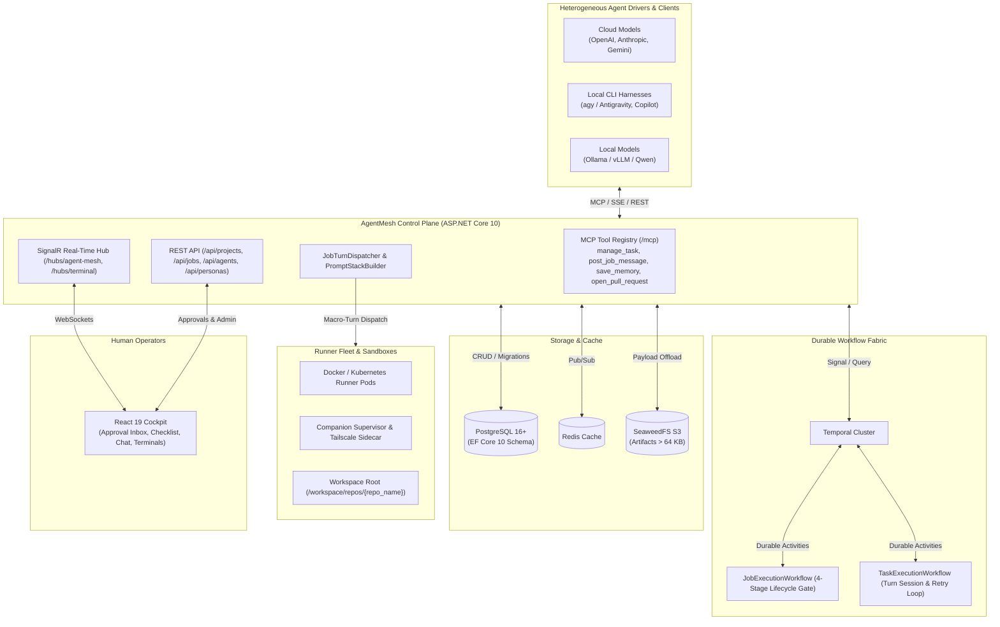
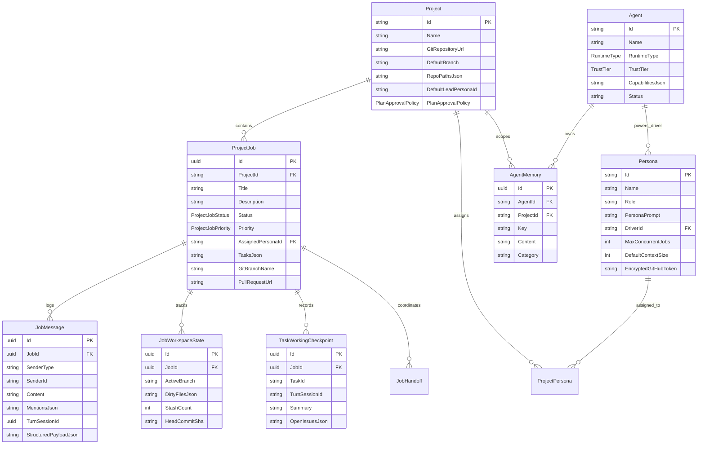

# AgentMesh: Heterogeneous Agent Control Plane & Communication Bus

## 1. Executive Summary & Vision

**AgentMesh** is an enterprise-grade control plane, identity fabric, and durable execution engine for heterogeneous AI software engineering agents. It connects external cloud agents (OpenAI, Anthropic Claude, Gemini), local terminal coding harnesses (`agy` / Antigravity), self-hosted LLMs (Qwen/Llama via Ollama/vLLM), and IDE assistants (GitHub Copilot) into a coordinated development team.

### Core Problems Solved

1. **Job-First Autonomous Lifecycle**: Replaces unstructured, ephemeral chat turns with structured, multi-stage engineering jobs featuring strict discovery phases, plan alignment gates, sequential checklist execution, and mandatory two-man review verification.
2. **KV Prefix Cache Preservation**: Eliminates cache thrashing and optimizes inference costs through a 6-layer volatility-ordered prompt stack that physically isolates long-lived invariants from per-turn volatile state.
3. **Decoupled Identity vs. Runtime**: Separates **Personas** (semantic roles, specialized system prompts, context budgets, GitHub credentials) from **Drivers** (technical runtime engines, API endpoints, model discovery, sidecar networks).
4. **Durable Multi-Agent Orchestration**: Powered by **Temporal**, workflows survive network cuts, pod restarts, rate limits, and days-long human review delays without holding open socket connections or risking corrupted state.
5. **Human-in-the-Loop (HITL) Observability**: Provides an interactive React 19 Cockpit backed by real-time SignalR event streaming, live interactive terminals, and multi-repo workspace tracking.

---

## 2. Technology Stack & Decision Matrix

| Layer | Technology | Justification |
| :--- | :--- | :--- |
| **Control Plane API** | ASP.NET Core 10 (`ModelContextProtocol.AspNetCore`) | Unified HTTP REST, Streamable HTTP / SSE Model Context Protocol (MCP) server at `/mcp`, and SignalR streaming hubs. |
| **Durable Execution** | Temporal (`Temporalio` .NET SDK) | Distributed workflow engine delivering crash-proof orchestration, durable timers, signal-driven human approvals, and activity retries. |
| **Canonical Store** | PostgreSQL 16+ via EF Core 10 | Stores relational project hierarchies, personas, drivers, job lifecycles, structured checklists (JSONB), and audit ledgers. |
| **Large Payload Offload** | SeaweedFS (S3-Compatible) | Transparently offloads execution artifacts, compilation traces, and payloads exceeding 64 KB from PostgreSQL and Temporal gRPC envelopes. |
| **Ephemeral Cache & Pub/Sub** | Redis 7+ | Handles low-latency distributed locks, heartbeat tracking, and cross-instance notification fan-out. |
| **Frontend Cockpit** | React 19 + Vite + Tailwind CSS + shadcn/ui | Real-time human approval inbox, living task checklists, Job Chat, driver configuration modal, and terminal streams. |
| **Local Orchestrator** | .NET 10 Aspire (`Aspire.AppHost`) | Single-command developer environment (`dotnet run --project src/AgentMesh.AppHost`) with OpenTelemetry telemetry. |
| **Cloud Deployment** | Kubernetes via Helm | Declarative Helm charts deploying scalable API, Worker, and Runner pods against cluster-native PostgreSQL, Redis, and Temporal. |

---

## 3. High-Level System Architecture

---

## 4. Core Domain Entities & Relational Schema

AgentMesh models autonomous engineering work with a normalized relational schema:

---

## 5. The 4-Stage Autonomous Job Lifecycle

Engineering tasks follow an autonomous lifecycle enforced by `JobExecutionWorkflow`:

1. **Stage 1: Discovery & Planning**
   * Persona operates in read-only mode (`grep`, `find`, `read_file`, `git log`). File edits are prohibited.
   * Agent decomposes requirements into 3–6 verifiable tasks via `manage_task(action: "set_checklist")`.
   * Posts plan to Job Chat via `post_job_message(requires_reply: true)` and yields turn.
2. **Stage 2: Plan Alignment Gate**
   * Workflow pauses execution until an operator or assigned team lead approves the checklist.
   * Evaluated automatically if `PlanApprovalPolicy == Automatic` or durably held if `ManualReviewRequired`.
3. **Stage 3: Task Execution & Observability**
   * Tasks are executed sequentially with status updates via `manage_task(action: "update_task_status")`.
   * 1-sentence progress note heartbeats stream to the Cockpit.
   * **The 3-Strike Rule**: If an agent fails 3 consecutive edit-and-test attempts, it reverts dirty changes (`git checkout --`), halts, and escalates to the supervisor via `post_job_message`.
4. **Stage 4: Verification & Two-Man Review**
   * Verification test suite executes in full.
   * Agent calls `open_pull_request`.
   * **Anti-Self-Merge Rule**: Agents cannot approve or merge their own PRs. Turn is yielded to the assigned reviewer.

---

## 6. Prompt Stack Architecture: 6 Volatility-Ordered Layers

To maximize inference engine KV prefix caching, `PromptStackBuilder` composes turns into six strictly ordered layers:

* **Layer 1: Platform Invariants** (100% Static) – Core rules of engagement, 3-strike rule, sandbox constraints.
* **Layer 2: Master Persona Prompt** (Static per Persona) – Behavioral instructions, role definition.
* **Layer 3: Project Manifest** (Static per Project) – Repository paths, architecture conventions.
* **Layer 4: Team Topology & Escalations** (Semi-Dynamic) – Project roster from `project_personas` with self-escalation deadlock prevention.
* **Layer 5: Persistent Agent Memories** (Low Volatility) – Project-specific notes from `save_memory`, capped at 40 entries.
* **Layer 6: Turn-0 Task Envelope** (High Volatility) – Physically isolated as the User message, containing task acceptance criteria, active branch, and live git probe state.

---

## 7. Platform MCP Tools & Wire Contracts

Autonomous agents interact with the platform through `/mcp`:

* [`manage_task`](specs/platform-mcp-tools-and-contracts.md#31-manage_task): Manipulates the living task checklist and statuses (`set_checklist`, `update_task_status`, `get_checklist`).
* [`post_job_message`](specs/platform-mcp-tools-and-contracts.md#32-post_job_message): Posts to Job Chat, tags teammates with `@mentions`, surfaces 3-R escalations (Result, Reasoning, Risk), or pauses turn execution (`requires_reply: true`).
* [`save_memory`](specs/platform-mcp-tools-and-contracts.md#33-save_memory): Retains codebase quirks, environment fixes, and architectural learnings across sessions.
* [`open_pull_request`](specs/platform-mcp-tools-and-contracts.md#34-open_pull_request): Triggers the Stage 4 Two-Man Review gate.

---

## 8. Modular System Specifications Index

For detailed deep-dives into individual subsystems, refer to the living specifications:

| Living Specification | Scope |
| :--- | :--- |
| 📋 [**Job Lifecycle & Temporal Workflows**](specs/job-lifecycle-and-workflows.md) | 4-stage execution gates, Temporal workflows, macro-turn dispatching, and handoff reapers. |
| 🧠 [**Prompt Stack Architecture**](specs/prompt-stack-architecture.md) | 6-layer volatility ordering, prefix cache optimization, sliding windows, and payload caps. |
| 🤖 [**Personas, Drivers & Runners**](specs/personas-drivers-and-runners.md) | Decoupled personas vs drivers, container managers, companion supervisors, and sidecars. |
| 🛠️ [**Platform MCP Tools & Contracts**](specs/platform-mcp-tools-and-contracts.md) | Wire contracts, schemas, 3-R escalation formats, and SignalR live broadcasting. |
| 📦 [**Archived Development Phases**](archive/phases/) | Historical documentation covering initial bootstrap phases 1 through 7. |
