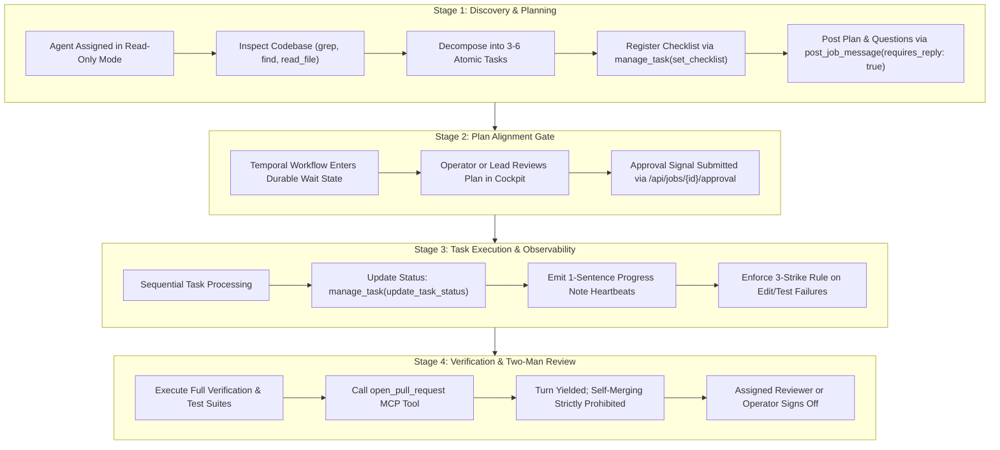
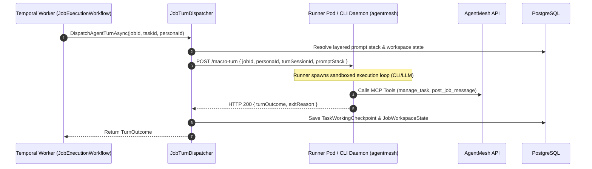

# Job-First Autonomous Lifecycle & Temporal Workflows

## 1. Overview & Core Philosophy

AgentMesh coordinates autonomous coding agents through a **Job-First Autonomous Lifecycle**. Rather than treating agent interactions as disconnected, stateless prompt-response chats, AgentMesh models engineering work as structured, durable **Project Jobs** with strict alignment gates, living task checklists, multi-repo workspace isolation, and two-man review verification.

All asynchronous and long-running execution is governed durably by **Temporal** workflows, ensuring that network interruptions, pod restarts, runner timeouts, or days-long review delays never drop state or corrupt job progress.

---

## 2. The 4-Stage Autonomous Job Lifecycle

Every `ProjectJob` in AgentMesh progresses through four formal stages:

### Stage 1: Discovery & Planning
* **Execution Boundary**: When a job is in `pending_discovery` or lacks an approved checklist, the assigned persona operates strictly in read-only mode.
* **Prohibited Actions**: File edits, git commits, destructive branch resets, or code generation.
* **Required Output**:
  1. Decompose the job objective into **3 to 6 atomic, verifiable tasks**.
  2. Call `manage_task(action: "set_checklist", tasks: [...])`.
  3. Post the proposed plan and any architectural trade-offs to the Job Chat via `post_job_message(requires_reply: true)`.
  4. Conclude the turn immediately without attempting code modifications.

### Stage 2: Plan Alignment Gate
* **Enforcement**: The underlying `JobExecutionWorkflow` halts turn dispatching and parks the job in `blocked` or `waiting_for_approval`.
* **Escalation Notification**: SignalR emits a real-time event to the Web Cockpit, rendering interactive approval buttons and diff views for the human operator or assigned tech lead.
* **Resumption**: Upon approval via `POST /api/jobs/{id}/approval`, Temporal receives the `SubmitApproval` signal and transitions the job to `in_progress`.

### Stage 3: Task Execution & Observability
* **Task-by-Task Focus**: The agent executes checklist items sequentially, calling `manage_task(action: "update_task_status", task_id: "...", status: "in_progress")`.
* **Heartbeat Observability**: With every status transition, the agent provides a concise, 1-sentence `progress_note` so operators can follow real-time status without inspecting raw terminal dumps.
* **The 3-Strike Rule**: If an agent attempts 3 consecutive unsuccessful edit-test iterations to resolve an error:
  1. The agent must revert its dirty changes (`git checkout -- <files>`).
  2. It must halt execution and escalate the blocker via `post_job_message(requires_reply: true)` following the 3-R format (Result, Reasoning, Risk).
  3. The turn yields immediately to prevent runaway token spend and model hallucination spirals.

### Stage 4: Verification & Two-Man Review
* **Final Verification**: Once all checklist tasks are marked `completed`, the agent executes full verification (unit tests, integration tests, linters).
* **PR Creation**: The agent invokes `open_pull_request(title: "...", body: "...")`.
* **Strict Anti-Self-Merge Policy**: Agents are strictly forbidden from self-approving or self-merging their own pull requests. Calling `open_pull_request` transitions the job to `needs_review` and durably yields the turn to the designated human operator or review persona.

---

## 3. Temporal Workflow Architecture

AgentMesh isolates durable execution into dedicated workflow definitions registered on the Temporal cluster:

### `JobExecutionWorkflow`
* **Purpose**: Manages the overarching lifecycle of a `ProjectJob` across days or weeks.
* **Key Signals**:
  * `SubmitApproval(bool approved, string? note)`: Unblocks the Stage 2 plan alignment gate or human escalation.
  * `TaskCompleted(string taskId, string summary)`: Signals completion of an individual checklist item.
  * `TurnResumed(string personaId)`: Signals that a blocked agent has received human/peer input in Job Chat.
* **Durable Wait Handlers**: Uses `Workflow.WaitConditionAsync(...)` with configurable timeouts (up to 7 days) without holding active HTTP or database connection pools.

### `TaskExecutionWorkflow`
* **Purpose**: Coordinates an individual execution turn or task batch assigned to a specific persona.
* **Turn Session Tracking**: Generates a cryptographically unique `TurnSessionId` for each invocation, recording execution boundaries in `task_working_checkpoints`.
* **Retry & Failure Recovery**: Applies exponential backoff retry policies for transient network or container faults while surfacing non-retryable domain rejections to the Job Chat.

---

## 4. Macro-Turns & Turn Dispatching

Execution turns are dispatched through the control plane via `JobTurnDispatcher` and `HttpAgentTurnRunner`:

### Turn Timeout & Output Spillover Protection
* **Command Timeouts**: Shell executions inside runner environments are bounded by a strict 180-second timeout. Runaway processes are terminated via process-group `SIGTERM` followed by `SIGKILL`.
* **Spillover Redirection**: Any stdout or stderr output exceeding 60 lines or 4 KB is automatically redirected to `/tmp/agentmesh/runs/last_run.log`, preventing context window bloat while preserving full logs on disk for debugging.

---

## 5. Job Handoffs & Multi-Persona Collaboration

When a task requires cross-functional expertise (e.g. an Engineer escalating a schema change to an Architect, or yielding to a QA Engineer):
1. **Handoff Record**: A `JobHandoff` entity is created, capturing the source persona, target persona, active git branch, checkpoint hash, and handoff reason.
2. **Context Continuity**: The target persona resumes execution with the exact branch and workspace state recorded in the handoff.
3. **Reaper Background Service**: The `JobHandoffReaper` periodic background service monitors stale handoffs, re-queuing orphaned jobs or notifying operators if a designated reviewer remains unresponsive.
