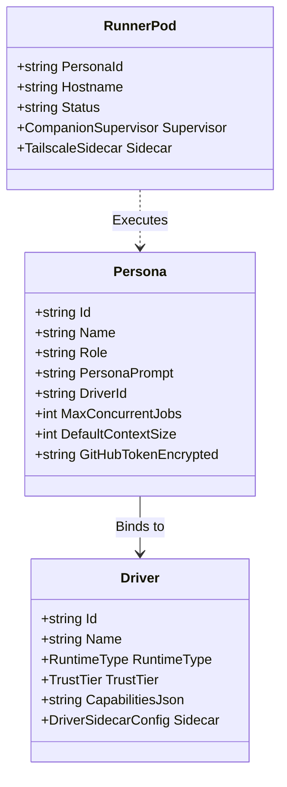
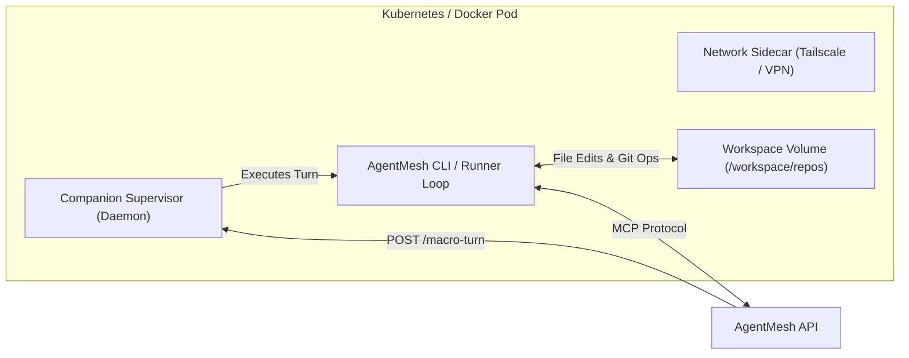

# Personas, Drivers & Runner Infrastructure

## 1. Architectural Decoupling: Persona vs. Driver

AgentMesh establishes a strict separation of concerns between **Personas** (the semantic role) and **Drivers** (the technical execution engine):

| Dimension | Persona (The Role) | Driver (The Engine) |
| :--- | :--- | :--- |
| **Concept** | Who the agent is (identity, specialization, role) | How the agent computes (model, API, CLI harness) |
| **Configuration** | `PersonaPrompt`, role, context budget, GitHub PATs | Endpoint, API keys, model presets, tool limits, timeouts |
| **Examples** | `system-architect`, `tech-lead`, `senior-engineer` | `openai-compatible`, `anthropic-claude`, `agy`, `copilot` |
| **Concurrency** | Governed by `MaxConcurrentJobs` (limits active turns) | Governed by rate limits and LLM provider token quotas |

---

## 2. Persona Specifications & Security

A [`Persona`](file:///home/ckingdon/projects/agent-mesh/src/AgentMesh.Core/Models/Persona.cs) represents a persistent identity within a development team:

* **Role Definition**: Specifies behavioral guidelines, domain authority, and escalation boundaries.
* **Concurrency Controls**: `MaxConcurrentJobs` ensures a persona is not overloaded with parallel macro-turns.
* **Context Size Budget**: `DefaultContextSize` configures the context window allocation for prompt stack generation.
* **Credential Encryption**: GitHub access tokens and private repository credentials stored on personas are encrypted at rest using AES-256-GCM via [`AesCredentialEncryptionService`](file:///home/ckingdon/projects/agent-mesh/src/AgentMesh.Infrastructure/Services/AesCredentialEncryptionService.cs). Decrypted keys are injected only into isolated runner memory spaces during active turns.

---

## 3. Driver Capabilities & Sidecar Configuration

Drivers are configured dynamically in the database (`agents` table) and managed through the REST API and Dashboard:

* **Model Discovery & Quota Probing**: [`DriverModelDiscovery`](file:///home/ckingdon/projects/agent-mesh/src/AgentMesh.Core/Services/DriverModelDiscovery.cs) and [`DriverQuotaProbe`](file:///home/ckingdon/projects/agent-mesh/src/AgentMesh.Api/Services/DriverQuotaProbe.cs) inspect backend endpoints (e.g. `/v1/models`) to determine available context lengths and vision support.
* **Driver Limits**: Configurable per-turn execution ceilings (`maxSteps`, `timeoutSeconds`, `maxRetries`).
* **Sidecar Networking (`DriverSidecarConfig`)**: Enables runner pods to join private enterprise meshes (e.g. Tailscale mesh networks) by injecting network sidecars with authenticated hostname tags.

---

## 4. Runner Infrastructure & Container Lifecycle

AgentMesh executes persona turns within isolated runner environments managed by [`IPersonaContainerManager`](file:///home/ckingdon/projects/agent-mesh/src/AgentMesh.Core/Services/IPersonaContainerManager.cs):

### Local Dev vs. Production Managers
* **Docker Container Manager**: [`DockerPersonaContainerManager`](file:///home/ckingdon/projects/agent-mesh/src/AgentMesh.Infrastructure/Containers/DockerPersonaContainerManager.cs) orchestrates ephemeral Docker containers for local developer runs in .NET Aspire.
* **Kubernetes Container Manager**: [`KubernetesPersonaContainerManager`](file:///home/ckingdon/projects/agent-mesh/src/AgentMesh.Infrastructure/Containers/KubernetesPersonaContainerManager.cs) manages StatefulSets or on-demand Pods in production Kubernetes clusters.

### Companion Supervisor & Auto-Updating
* **Process Supervisor**: Inside runner containers, a companion supervisor monitors process health, handles SIGTERM graceful drains, and exposes health probes.
* **Idle Auto-Updater**: When runner binaries or driver configurations are updated, idle runner pods automatically pull the latest binary release and restart cleanly without dropping active job sessions.

---

## 5. AgentMesh CLI (`agentmesh`)

The [`AgentMesh.Cli`](file:///home/ckingdon/projects/agent-mesh/src/AgentMesh.Cli/) project compiles into a cross-platform, single-file native executable (`dist/cli/linux-x64/agentmesh`):

* **Role**: Acts as the runner agent daemon connecting local LLM harnesses (`agy`, OpenAI-compatible engines, Copilot) to the AgentMesh control plane.
* **Adapters**: Implements provider-specific translation adapters (e.g. `OpenAiAdapter`) that map OpenAI Chat Completion APIs to streaming MCP tool execution.
* **SignalR Event Streaming**: Streams real-time thoughts, tool calls, and stdout logs to the Web Cockpit.
