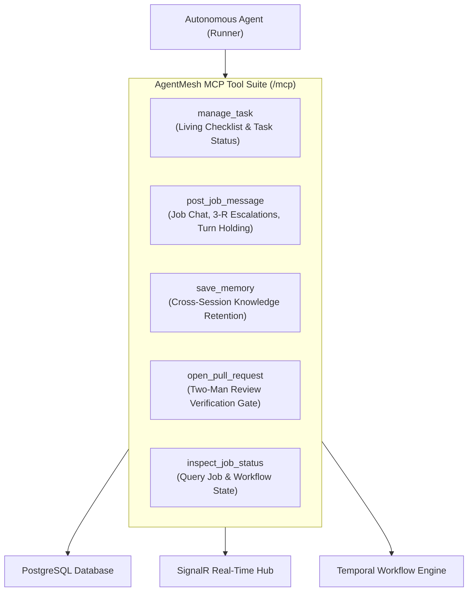

# Platform MCP Tools & Wire Contracts

## 1. Overview & Transport Protocol

AgentMesh provides tools to autonomous agents through the **Model Context Protocol (MCP)** specification. The control plane exposes an MCP-compliant endpoint at `/mcp` supporting Streamable HTTP and Server-Sent Events (SSE) transports via ASP.NET Core.

Tools are structured to eliminate interactive confirmation modals for autonomous agents while enforcing validation and deterministic status tracking across the platform.

---

## 2. Platform MCP Tool Suite

Platform tools are defined in [`PlatformMcpTools.cs`](file:///home/ckingdon/projects/agent-mesh/src/AgentMesh.Api/Tools/PlatformMcpTools.cs) and decorated with published schemas:

---

## 3. Tool Specifications & Contracts

### 3.1. `manage_task`
Manages the living checklist and individual task states for the active job.

* **Schema Constraints**: Arguments `action` and `status` are validated against strict string vocabularies defined in [`PlatformToolSchema.cs`](file:///home/ckingdon/projects/agent-mesh/src/AgentMesh.Api/Tools/PlatformToolSchema.cs):
  * **Allowed `action` values**:
    * `set_checklist`: Registers or updates the 3–6 atomic tasks identified during Stage 1 Discovery.
    * `update_task_status`: Updates execution status of a task (`pending`, `in_progress`, `completed`, `blocked`).
    * `get_checklist`: Retrieves the complete task array with current progress notes.
    * `get_details`: Fetches full metadata and acceptance criteria for a specific task.
* **Arguments**:
  | Name | Type | Required | Description |
  | :--- | :--- | :--- | :--- |
  | `action` | `string` | Yes | One of the allowed actions above. |
  | `task_id` | `string` | No | Identifier of the task being updated (e.g. `task-1`). |
  | `status` | `string` | No | Target status: `pending`, `in_progress`, `completed`, `blocked`. |
  | `progress_note` | `string` | No | 1-sentence heartbeat summarizing the state change. |
  | `tasks` | `array` | No | Full task checklist payload used with `set_checklist`. |

---

### 3.2. `post_job_message`
Posts an update, clarifying question, or architectural escalation to the job's shared ledger.

* **Target Resolution**:
  * Set `target_persona: "operator"` to address the human supervisor.
  * Set `target_persona` to a valid `Persona.Id` assigned to the project (derived from Layer 4 Team Topology).
* **Turn Holding (`requires_reply`)**:
  * When set to `true`, the platform pauses turn scheduling and marks the session as `waiting_for_input`. The agent must immediately conclude its turn.
* **3-R Escalation Format**:
  Escalations must follow the structured 3-R shape:
  * **Result**: What was attempted and the observed outcome/error.
  * **Reasoning**: Root-cause analysis of why the failure occurred.
  * **Risk**: The blast radius or proposed trade-offs requiring guidance.
* **Arguments**:
  | Name | Type | Required | Description |
  | :--- | :--- | :--- | :--- |
  | `content` | `string` | Yes | Markdown message body. |
  | `target_persona` | `string` | Yes | Recipient: `"operator"` or assigned persona ID. |
  | `requires_reply` | `bool` | Yes | If true, halts turn and parks session awaiting response. |
  | `job_id` | `string` | No | Optional job GUID (inferred from session if omitted). |

---

### 3.3. `save_memory`
Stores persistent architectural notes, codebase quirks, or test workarounds.

* **Scoped Key-Value Storage**: Records are persisted in `agent_memories` indexed by `(agent_id, project_id, memory_key)`.
* **Allowed Categories**:
  * `architecture`: Component boundaries, data invariants, and protocol specs.
  * `codebase_gotcha`: Hidden side effects, ordering requirements, or quirks.
  * `environment_quirk`: Path variables, container requirements, port bindings.
  * `test_strategy`: Required test flags, mocking constraints, or harness nuances.
  * `general`: Operational observations.
* **Arguments**:
  | Name | Type | Required | Description |
  | :--- | :--- | :--- | :--- |
  | `key` | `string` | Yes | Unique identifier (e.g. `ef-dbcontext-pooling-rule`). |
  | `content` | `string` | Yes | Concise documentation of the learned knowledge. |
  | `category` | `string` | Yes | One of the allowed categories above. |
  | `project_id` | `string` | No | Defaults to current active project. |

---

### 3.4. `open_pull_request`
Triggers the Stage 4 Two-Man Review gate by submitting the active branch for review.

* **Anti-Self-Merge Rule**: Calling `open_pull_request` immediately yields the agent's turn and transitions the job to `needs_review`. The agent cannot approve or merge its own PR.
* **Arguments**:
  | Name | Type | Required | Description |
  | :--- | :--- | :--- | :--- |
  | `title` | `string` | Yes | Pull request title following Conventional Commits. |
  | `body` | `string` | Yes | Summary of changes, verification commands, and test results. |
  | `target_branch` | `string` | No | Base branch to target (defaults to project default branch). |

---

## 4. Real-Time SignalR Events

Mutations emitted through MCP tools broadcast events to the Web Cockpit via [`AgentMeshHub`](file:///home/ckingdon/projects/agent-mesh/src/AgentMesh.Api/Hubs/AgentMeshHub.cs) (`/hubs/agent-mesh`):

* `ReceiveJobMessage`: Emitted when `post_job_message` creates a new chat row.
* `ReceiveTaskUpdate`: Emitted when `manage_task` updates task status or checklist items.
* `ReceiveApprovalRequest`: Emitted when a job enters Stage 2 or requires human escalation.
* `ReceiveAgentStatus`: Broadcasts real-time runner heartbeat and pod states.
