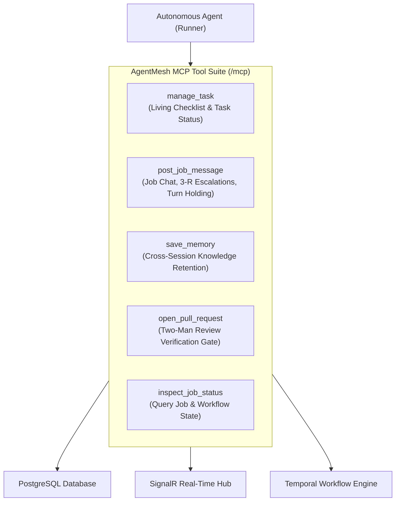

# Platform MCP Tools & Wire Contracts

## 1. Overview & Transport Protocol

AgentMesh provides tools to autonomous agents through the **Model Context Protocol (MCP)** specification. The control plane exposes an MCP-compliant endpoint at `/mcp` supporting Streamable HTTP and Server-Sent Events (SSE) transports via ASP.NET Core.

Tools are structured to eliminate interactive confirmation modals for autonomous agents while enforcing validation and deterministic status tracking across the platform.

---

## 2. Platform MCP Tool Suite

Platform tools are defined in [`PlatformMcpTools.cs`](file:///home/ckingdon/projects/agent-mesh/src/AgentMesh.Api/Tools/PlatformMcpTools.cs) and decorated with published schemas:

---

## 3. Tool Specifications & Contracts

### 3.1. `manage_task`
Manages the living checklist and individual task states for the active job.

* **Schema Constraints**: Arguments `action` and `status` are validated against strict string vocabularies defined in [`PlatformToolSchema.cs`](file:///home/ckingdon/projects/agent-mesh/src/AgentMesh.Api/Tools/PlatformToolSchema.cs):
  * **Allowed `action` values**:
    * `set_checklist`: Registers or updates the 3–6 atomic tasks identified during Stage 1 Discovery.
    * `update_task_status`: Updates execution status of a task (`pending`, `in_progress`, `completed`, `blocked`).
    * `get_checklist`: Retrieves the complete task array with current progress notes.
    * `get_details`: Fetches full metadata and acceptance criteria for a specific task.
* **Arguments**:
  | Name | Type | Required | Description |
  | :--- | :--- | :--- | :--- |
  | `action` | `string` | Yes | One of the allowed actions above. |
  | `task_id` | `string` | No | Identifier of the task being updated (e.g. `task-1`). |
  | `status` | `string` | No | Target status: `pending`, `in_progress`, `completed`, `blocked`. |
  | `progress_note` | `string` | No | 1-sentence heartbeat summarizing the state change. |
  | `tasks` | `array` | No | Full task checklist payload used with `set_checklist`. |

---

### 3.2. `post_job_message`
Posts an update, clarifying question, or architectural escalation to the job's shared ledger.

* **Target Resolution**:
  * Set `target_persona: "operator"` to address the human supervisor.
  * Set `target_persona` to a valid `Persona.Id` assigned to the project (derived from Layer 4 Team Topology).
* **Turn Holding (`requires_reply`)**:
  * When set to `true`, the platform pauses turn scheduling and marks the session as `waiting_for_input`. The agent must immediately conclude its turn.
* **3-R Escalation Format**:
  Escalations must follow the structured 3-R shape:
  * **Result**: What was attempted and the observed outcome/error.
  * **Reasoning**: Root-cause analysis of why the failure occurred.
  * **Risk**: The blast radius or proposed trade-offs requiring guidance.
* **Arguments**:
  | Name | Type | Required | Description |
  | :--- | :--- | :--- | :--- |
  | `content` | `string` | Yes | Markdown message body. |
  | `target_persona` | `string` | Yes | Recipient: `"operator"` or assigned persona ID. |
  | `requires_reply` | `bool` | Yes | If true, halts turn and parks session awaiting response. |
  | `job_id` | `string` | No | Optional job GUID (inferred from session if omitted). |

---

### 3.3. `save_memory`
Stores persistent architectural notes, codebase quirks, or test workarounds.

* **Scoped Key-Value Storage**: Records are persisted in `agent_memories` indexed by `(agent_id, project_id, memory_key)`.
* **Allowed Categories**:
  * `architecture`: Component boundaries, data invariants, and protocol specs.
  * `codebase_gotcha`: Hidden side effects, ordering requirements, or quirks.
  * `environment_quirk`: Path variables, container requirements, port bindings.
  * `test_strategy`: Required test flags, mocking constraints, or harness nuances.
  * `general`: Operational observations.
* **Arguments**:
  | Name | Type | Required | Description |
  | :--- | :--- | :--- | :--- |
  | `key` | `string` | Yes | Unique identifier (e.g. `ef-dbcontext-pooling-rule`). |
  | `content` | `string` | Yes | Concise documentation of the learned knowledge. |
  | `category` | `string` | Yes | One of the allowed categories above. |
  | `project_id` | `string` | No | Defaults to current active project. |

---

### 3.4. `open_pull_request`
Triggers the Stage 4 Two-Man Review gate by submitting the active branch for review.

* **Anti-Self-Merge Rule**: Calling `open_pull_request` immediately yields the agent's turn and transitions the job to `needs_review`. The agent cannot approve or merge its own PR.
* **Arguments**:
  | Name | Type | Required | Description |
  | :--- | :--- | :--- | :--- |
  | `title` | `string` | Yes | Pull request title following Conventional Commits. |
  | `body` | `string` | Yes | Summary of changes, verification commands, and test results. |
  | `target_branch` | `string` | No | Base branch to target (defaults to project default branch). |

---

## 4. Real-Time SignalR Events

Mutations emitted through MCP tools broadcast events to the Web Cockpit via [`AgentMeshHub`](file:///home/ckingdon/projects/agent-mesh/src/AgentMesh.Api/Hubs/AgentMeshHub.cs) (`/hubs/agent-mesh`):

* `ReceiveJobMessage`: Emitted when `post_job_message` creates a new chat row.
* `ReceiveTaskUpdate`: Emitted when `manage_task` updates task status or checklist items.
* `ReceiveApprovalRequest`: Emitted when a job enters Stage 2 or requires human escalation.
* `ReceiveAgentStatus`: Broadcasts real-time runner heartbeat and pod states.

---

## 5. Which runtimes actually mount these tools

The API serves this suite over MCP at `/mcp` (`app.MapMcp("/mcp")`), but serving a suite is not the same as a
driver having it mounted, and the difference decides whether a Stage 1B checklist exists at all.

| Runtime | How it reaches `manage_task` / `post_job_message` / `open_pull_request` |
| :--- | :--- |
| Function-tool adapters (Codex/OpenAI-style) | In-process tool schemas declared by the adapter; the call is executed by the runner and forwarded to `POST /mcp`. The tool call is recorded in `session_messages` as a `tool_call` row. |
| Subprocess drivers: `claude -p`, `copilot`, `agy` | **Through the shell, since 2.6.2:** `agentmesh task set-checklist|update-status|get-checklist` and `agentmesh message post`, which post to the same `POST /mcp` path the adapters use. `agy mcp list` still answers "No MCP servers configured" — nothing is mounted *into* these drivers, by design (see 5.3). |

### 5.1. The Antigravity name collision

`ask_question` and `manage_task` are also **Antigravity's own built-in tool names** — they appear in its
bundled skills (`builtin/skills/automation/SKILL.md`, `builtin/skills/swarm_monitor/SKILL.md`), where
`manage_task` is its background-shell manager with `Action: list | kill | status | send_input`.

So when a persona on the `agy` driver calls `manage_task(action: "set_checklist")`:

* the call goes to Antigravity's own task manager and succeeds there, silently;
* the runner forwards the tool call to the platform under the same name, so a `tool_call` row with
  `tool_name = manage_task` exists and can be mistaken for a platform tool that ran;
* `project_jobs.tasks` is never written, so Stage 1B finds an empty checklist and the plan gate is built from
  the activity's fallback breakdown instead of the agent's decomposition.

Questions survive this only because `ask_question` happens to be a real Antigravity tool:
`AgyAdapter.CheckForAskQuestionToolCall` scrapes it out of
`~/.gemini/antigravity-cli/brain/<id>/.system_generated/logs/transcript.jsonl`, and the platform renders the
question in the session chat.

### 5.2. Reading a recorded `ask_question`

Arguments recorded for `ask_question` are not one shape. Antigravity serialises its array parameter as a
string, so `session_messages.tool_args` holds `{"questions":"[{...}]"}`, and the runner forwards that verbatim.
`AgentMesh.Core.Models.AskQuestionPayload` is the single reader of every accepted shape (array, encoded-array
string, bare array, single-question object, `snake_case` and `camelCase` keys) and is what both the Stage 1
activity and the session answer path go through. A reader that accepts only one shape does not fail loudly —
it fails as a confident "no questions were asked", which is how job `c28eca57` walked into its plan gate while
two questions sat answered in the transcript.

### 5.3. What shipped for subprocess drivers (2.6.2)

`PlatformToolCommand` adds `agentmesh task …` and `agentmesh message post`. They are not a second
implementation: each builds the tool's argument document and hands it to
`MeshClient.CallPlatformMcpToolAsync`, so validation, provenance and job linkage stay in `PlatformMcpTools`
and cannot drift from what a function-tool adapter sends.

Why a CLI verb rather than `agy mcp add`, which was the other candidate:

* the call needs **per-turn** context. `PlatformCallContextResolver` derives the job, task and branch from
  the `X-Session-Id` of the turn making the call, and one persona container serves many jobs, so a static
  MCP registration with fixed headers cannot express it. The runner instead exports
  `AGENTMESH_SESSION_ID`, `AGENTMESH_JOB_ID`, `AGENTMESH_PERSONA_ID` and `AGENTMESH_DRIVER_ID` into every
  driver child process (`AgentAdapterFactory.ApplyMeshTurnContext`), and a shell inherits them for free.
* a shell command cannot be shadowed the way a tool name can. There is one `agentmesh` on `PATH` and it is
  this one; `manage_task` is not, on Antigravity.

The name collision itself is deliberately not "fixed" by renaming the platform tools. `manage_task` is the
wired contract for every function-tool adapter and for recorded transcripts; what changed instead is that a
driver that cannot reach it is now told so, and the failure cannot stay hidden:

* `PlatformPrompts.PlatformInvariants` names the shell verbs and warns that a harness built-in called
  `manage_task` reports nothing to the platform; the same text is in
  `AgentAdapterFactory.ControlPlaneShellRouteInstructions`, which is what a chat turn gets.
* `ExecuteDecompositionActivityAsync` no longer substitutes a hardcoded breakdown when a decomposition
  registers nothing. The gate title becomes "Plan Approval: No Checklist Registered", the reasoning says why
  and names the verb, and the worker logs a warning — the incident was silent at every layer, and the absence
  of a checklist is now the loudest thing about it.
* `JobExecutionWorkflow` halts if an empty checklist is approved
  (`JobExecutionWorkflow.EmptyChecklistHaltMessage`) rather than opening a pull request for work that was
  never planned.

Known limits, stated rather than hidden: a shell call lands as a platform tool call under `manage_task`, so
it is still indistinguishable in `session_messages` from a shadowed built-in — what makes it trustworthy is
that the job's `tasks` row changed. And `agentmesh message post` is not a question channel: only
`ask_question` produces something the operator can answer.
