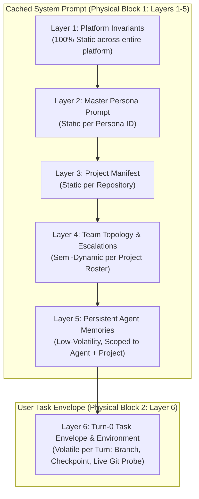

# Prompt Stack Architecture & Context Layering

## 1. Problem Statement: Prefix Caching & Prompt Volatility

Modern Large Language Model (LLM) inference engines (vLLM, Ollama, Anthropic, OpenAI, Gemini) employ **KV (Key-Value) prefix caching** to accelerate time-to-first-token (TTFT) and dramatically cut inference costs. Prefix caches match prompt strings byte-for-byte from index 0.

If a highly volatile value—such as a current timestamp, an active git branch, a list of dirty files, or a task ID—is placed early in the system prompt, every byte positioned after it suffers a cache miss on every single turn.

AgentMesh solves this through **Strict Volatility-Ordered Layering** implemented in [`PromptStackBuilder`](file:///home/ckingdon/projects/agent-mesh/src/AgentMesh.Worker/Services/PromptStackBuilder.cs).

---

## 2. The 6 Volatility-Ordered Layers

The prompt stack is composed of six distinct layers ordered strictly from least volatile (100% static) to most volatile (per-turn dynamic):



### Layer 1: Platform Invariants
* **Volatility**: 100% Static.
* **Scope**: Global across every agent, project, and session.
* **Contents**: The core rules of engagement defined in `PlatformPrompts.PlatformInvariants`:
  * 4-Stage Autonomous Job Lifecycle.
  * Sandbox execution rules (working root `/workspace/repos/{repo_name}`, 180s command timeouts, 60-line/4KB output redirection).
  * 3-Strike Failure Escalation Rule.
  * PR anti-self-merge policy.

### Layer 2: Master Persona Prompt
* **Volatility**: Static per Persona.
* **Scope**: Tied to the assigned `Persona.Id`.
* **Contents**: The persona's core architectural identity, coding standards, language specialties, and operational mindset (stored in `personas.persona_prompt`).

### Layer 3: Project Manifest
* **Volatility**: Static per Repository / Project.
* **Scope**: Scoped to `Project.Id`.
* **Contents**: Authoritative project metadata: repository name, primary language conventions, framework configurations, and team-specific instructions.

### Layer 4: Team Topology & Escalation Paths
* **Volatility**: Semi-Dynamic per Project Roster.
* **Scope**: Rendered directly from `project_personas`.
* **Ordering**: Strictly sorted by `Role` then `Name` to maintain deterministic byte stability across turns.
* **Deadlock Protection**: Emits `member.IsSelf` annotations (`"this is you; never escalate to yourself"`). This prevents the self-escalation deadlock where an agent assigned as Tech Lead attempts to escalate a task to itself.

### Layer 5: Persistent Agent Memories
* **Volatility**: Low Volatility.
* **Scope**: Filtered by `(AgentId, ProjectId)`.
* **Cap Guardrail**: Bounded by `MaxRenderedMemories = 40` most recent relevant entries.
* **Contents**: Durable notes, codebase quirks, environment fixes, and verified workarounds previously captured via the `save_memory` tool.

### Layer 6: Turn-0 Task Envelope & Live Environment
* **Volatility**: High (Volatile per turn).
* **Physical Isolation**: Dispatched strictly as the primary `user` message envelope rather than appended to the system block.
* **Contents**:
  * Authoritative working directory (`Working Root: ... — authoritative; do not run pwd or ls to confirm it`).
  * Target project & task ID with acceptance criteria.
  * Active Git branch.
  * Living checklist progression (`manage_task`).
  * **Live Environment Probe Note**: Recent uncommitted diff counts, HEAD commit SHA, and stash entries from `WorkspaceReconciliationReport`, eliminating wasted initial tool calls querying `git status`.

---

## 3. Physical Prompt Separation Contract

The returned data structure [`AssembledPromptStack`](file:///home/ckingdon/projects/agent-mesh/src/AgentMesh.Core/Services/IPromptStackBuilder.cs) enforces a hard physical boundary:

```csharp
public record AssembledPromptStack(
    string CachedSystemPrompt,     // Layers 1 through 5 (Maximized Prefix Cache Hit)
    string UserTaskEnvelope,       // Layer 6 (Turn-specific user turn)
    IReadOnlyList<SessionMessage> SlidingWindow, // Filtered chat history
    string WorkspacePath
);
```

By physically separating `CachedSystemPrompt` from `UserTaskEnvelope`, caller harnesses and runner adapters cannot accidentally concatenate them into a single invalidating block without explicit intent.

---

## 4. Sliding Window & Payload Protection

Historical session messages are pruned and capped before inclusion in the final dispatch payload:
* **Window Size**: Defaults to `DefaultSlidingWindowSize = 15` messages (configurable up to `MaxSlidingWindowSize = 60`).
* **Per-Message Truncation Cap**: Individual message bodies within the history window are capped at 4,000 characters. This prevents historical build dumps (e.g. 50 KB compilation traces) from filling the model's context window while retaining essential reasoning and error traces.

---

## 5. Graceful Degradation & Resilience

`PromptStackBuilder` wraps all external queries (EF Core database reads, Redis caches, git filesystem probes) in defensive exception blocks.

If an auxiliary component (such as the memory repository or a git status probe) experiences a transient timeout or failure, that individual layer degrades gracefully with an explanatory fallback comment. The turn continues execution rather than aborting the workflow.
